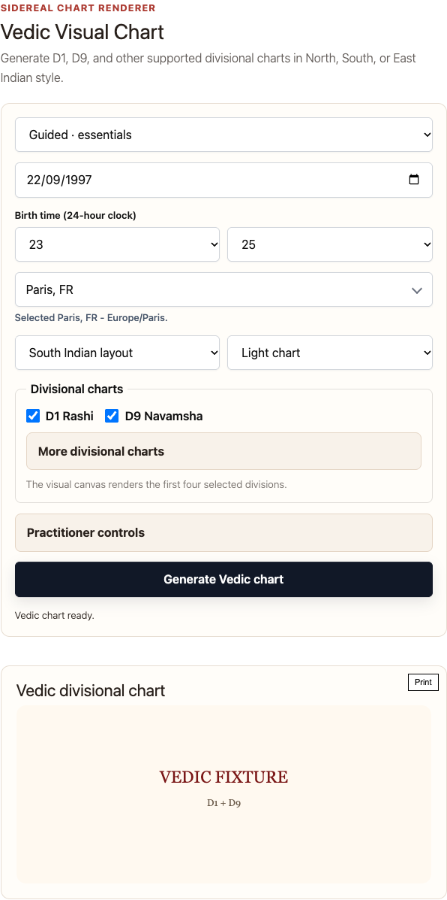
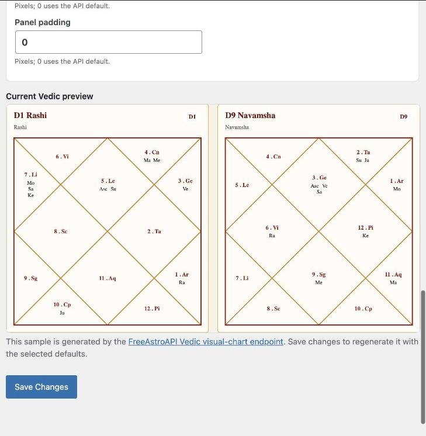
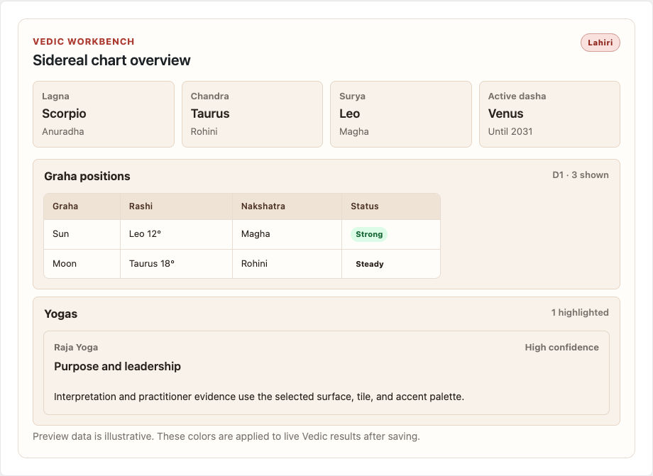
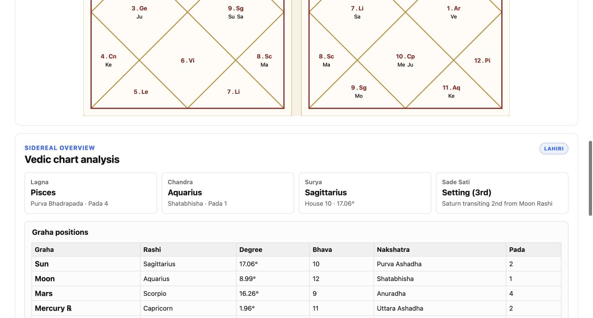

# Astrology Suite for FreeAstroAPI

Publish Western and Vedic charts, reports, horoscopes, ephemerides, practitioner references, and an astrology bot from one WordPress plugin.

The site owner saves one FreeAstroAPI key in `Settings > Astrology Suite > API` and sets the request-per-second limit for that key's current plan. Visitors use the published widgets without entering or receiving the key.

## Includes

- Shared Astrology Suite settings page (`Settings > Astrology Suite`)
- REST proxy endpoints:
  - `GET /wp-json/astrology-suite/v1/geo/search`
  - `POST /wp-json/astrology-suite/v1/natal/calculate`
  - `POST /wp-json/astrology-suite/v1/natal/chart-svg`
  - `POST /wp-json/astrology-suite/v1/western/simple-signs`
  - `POST /wp-json/astrology-suite/v1/western/ephemeris`
  - `POST /wp-json/astrology-suite/v1/western/daily-horoscope`
  - `POST /wp-json/astrology-suite/v1/western/personalized-horoscope`
  - `POST /wp-json/astrology-suite/v1/vedic/visual-chart`
  - `POST /wp-json/astrology-suite/v1/vedic/calculate`
  - `POST /wp-json/astrology-suite/v1/astrology-bot/chat`
- Gutenberg blocks (each includes the input form):
  - `astrology-suite/chart-only`
  - `astrology-suite/report-only`
  - `astrology-suite/chart-report`
  - `astrology-suite/simple-sign-sun`
  - `astrology-suite/simple-sign-moon`
  - `astrology-suite/simple-sign-rising`
  - `astrology-suite/simple-sign-midheaven`
  - `astrology-suite/ephemeris`
  - `astrology-suite/daily-horoscope`
  - `astrology-suite/personalized-horoscope`
  - `astrology-suite/vedic-chart`
  - `astrology-suite/vedic-workbench`
  - `astrology-suite/astrology-bot`
- Shortcodes:
  - `[astrology_suite mode="chart-report"]`
  - `[astrology_suite mode="chart-report" language="vi"]`
  - `[astrology_suite_chart_only]`
  - `[astrology_suite_report_only]`
  - `[astrology_suite_chart_report]`
  - `[astrology_suite_simple_sign_sun include_interpretation="true" interpretation_style="improved"]`
  - `[astrology_suite_simple_sign_moon include_interpretation="false"]`
  - `[astrology_suite_simple_sign_rising include_interpretation="true" interpretation_style="poetic"]`
  - `[astrology_suite_simple_sign_midheaven]`
  - `[astrology_suite_ephemeris]`
  - `[astrology_suite_daily_horoscope]`
  - `[astrology_suite_personalized_horoscope]`
  - `[astrology_suite_vedic_chart]`
  - `[astrology_suite_vedic_workbench]`
  - `[astrology_suite_astrology_bot]`

## Notes

- `Chart only` does not render a legend.
- `Ephemeris` renders a monthly FreeAstroAPI table grid with body filters, tropical/sidereal mode, optional city for local points, CSV download, and table-specific style controls.
- `Daily Horoscope` renders a sign/date/timezone form and uses the FreeAstroAPI Daily Sign Horoscope endpoint for scores, lucky attributes, guidance, and sky highlights.
- `Personalized Horoscope` renders birth details, city autocomplete, target date, and a personalized daily horoscope using current sky timing and personal transit context.
- `Vedic Visual Chart` renders D1, D9, or other supported vargas in North, South, or East Indian layouts with configurable themes and graha label styles.
- `Vedic Astrology Workbench` adds practitioner controls and readable references for graha positions, active Vimshottari dashas, yogas/doshas, birth Panchang, Shadbala, Ashtakavarga, and selected vargas.
- `Settings > Astrology Suite > Vedic Chart` controls the frontend Vedic layout, theme, node, sign/graha labels, optional outer planets, titles, colors, sizing overrides, and an API-generated D1/D9 preview. House labels remain hidden.
- `Settings > Astrology Suite > Style` includes a no-request live preview and dedicated Vedic controls for workbench surfaces, text, borders, accents, summary tiles, table headers, and badges.
- `Astrology Bot` renders a Western/Vedic chat component with birth profile collection. The saved FreeAstroAPI key powers MCP astrology tool calls. On WordPress 7.0+, connect Google under `Settings > Connectors` for the answer layer; the legacy Gemini field is only for older WordPress versions.
- Report rendering can be customized in plugin settings.
- `Settings > Astrology Suite > Objects` selects one Western house system and one lunar-node mode (True, Mean, or None) for all Western natal outputs.
- Report output can include birth context, optional themed interpretation groups, and clickable planet aspect links that open the matching FreeAstroAPI interpretation block in a modal; this does not use the psychological report flow.
- Chart SVG/PNG styling can be customized from the Custom Chart tab with presets, FreeAstroAPI-generated PNG previews, per-theme chart request bodies, or a custom chart_config JSON object from the FreeAstroAPI Chart Designer. Managed house-system, zodiac, node, and object settings remain controlled by the Objects tab so wheel and report calculations cannot diverge.
- Admin chart previews wait for the configured site-wide RPS slot, so Free-plan keys can populate every preview without simultaneous local-limit errors.
- Typography, colors, border, Vedic result styling, bot chat colors, and ephemeris table styling can be customized in plugin settings.
- Forms use explicit 24-hour controls (`00`-`23`) for birth time.
- After changing Report, Objects, Style, or Custom Chart settings, purge full-page, host, and CDN caches for the published chart page; exclude that page when configuration must always update immediately.
- Natal chart/report forms include an "I don't know my birth time" option. When selected, chart and report requests send `time_known: false` and angle/house-dependent report sections are skipped if the API omits them.
- Frontend UI text can be localized from settings or with the shortcode `language` attribute. Natal interpretation response language is controlled from `Settings > Astrology Suite > API` and can follow supported widget languages automatically.
- Container background transparency, inputs, buttons, and Past inputs visuals are customizable (visibility, radius, border, colors, placeholder, labels, focus ring).
- Forms include a local “Past inputs…” dropdown (last 20 successful requests, browser-local only).
- Public visitors can submit natal chart, report, simple-sign, ephemeris, daily horoscope, personalized horoscope, and astrology bot forms by default. Site admins can turn public calculations off in `Settings > Astrology Suite > API` to restrict calculations to logged-in users who can edit posts.
- Set `API requests per second` in `Settings > Astrology Suite > API` to the saved FreeAstroAPI key's plan throughput. The plugin defaults to 1 RPS, spaces authenticated requests site-wide, and automatically retries short RPS waits with jitter; FreeAstroAPI still enforces the plan's daily or monthly quota.
- CSS class reference:
  - [`docs/CSS-CLASSES.md`](docs/CSS-CLASSES.md)
- Visitor birth data is not persisted by default.

## Screenshots

### Vedic Visual Chart

### Vedic Chart settings

### Vedic style preview

### Vedic Astrology Workbench

## External services

Astrology Suite connects to [FreeAstroAPI](https://www.freeastroapi.com/) to autocomplete cities and generate astrology calculations. A standard chart/report installation only needs a FreeAstroAPI key. The optional Astrology Bot uses Google Gemini for its answer layer.

- City autocomplete sends the typed city query and optional country filter over HTTPS when someone types into the city field.
- Natal chart, report, simple-sign, ephemeris, daily horoscope, personalized horoscope, and astrology bot requests send submitted astrology data and calculation options over HTTPS when a visitor submits the form while public calculations are enabled, or when an authenticated editor submits while public calculations are disabled.
- Astrology bot requests may send the chat message, recent chat history, selected Western/Vedic system, and submitted birth profile to FreeAstroAPI MCP and Google Gemini over HTTPS. On WordPress 7.0+, Gemini access is managed by the Google provider connected under `Settings > Connectors`.
- Calculation requests also include the site's configured FreeAstroAPI key in the server-to-server request header. The API key is not sent to the visitor's browser.
- On WordPress versions before 7.0, Astrology bot answer requests use the legacy Gemini key saved in plugin settings. On WordPress 7.0+, the WordPress AI Client uses the Google connector, and the legacy key is ignored.
- The plugin does not store visitor birth data in WordPress by default. The optional “Past inputs” feature stores recent successful requests in the visitor's browser local storage only.
- Custom chart configs can be generated at [FreeAstroAPI Chart Designer](https://www.freeastroapi.com/dashboard/chart-designer), and per-theme request bodies follow the [FreeAstroAPI SVG/PNG chart endpoint](https://www.freeastroapi.com/docs/western/chart-svg).
- The ephemeris widget follows the [FreeAstroAPI Western Ephemeris endpoint](https://www.freeastroapi.com/docs/western/ephemeris).
- The daily horoscope widget follows the [FreeAstroAPI Daily Sign Horoscope endpoint](https://www.freeastroapi.com/docs/western/daily-sign).
- The personalized horoscope widget follows the [FreeAstroAPI Daily Personal Horoscope endpoint](https://www.freeastroapi.com/docs/western/daily-personal).
- The Vedic widgets follow the [FreeAstroAPI Vedic Visual Chart endpoint](https://www.freeastroapi.com/docs/vedic/visual-chart) and [Full Vedic Calculate endpoint](https://www.freeastroapi.com/docs/vedic/calculate).
- Plan-aware throttling follows the [FreeAstroAPI rate-limit behavior](https://www.freeastroapi.com/docs/rate-limits); configure the numeric RPS setting from the site owner's current plan.
- The natal report language setting follows the multilingual natal response behavior documented at [FreeAstroAPI Western Natal](https://www.freeastroapi.com/docs/western/natal).
- The astrology bot component is based on the [FreeAstroAPI Astrology Bot](https://www.freeastroapi.com/astrology-bot) experience.

Links:

- Terms of Service: [https://www.freeastroapi.com/terms](https://www.freeastroapi.com/terms)
- Privacy Policy: [https://www.freeastroapi.com/privacy](https://www.freeastroapi.com/privacy)
- Google Gemini API key docs for legacy WordPress versions: [https://ai.google.dev/gemini-api/docs/api-key](https://ai.google.dev/gemini-api/docs/api-key)

## Migration

- Old `freeastro/*` and `openastro/*` block names are legacy aliases.
- Use `Settings > Astrology Suite > Run Block Migrator` once to convert legacy content to `astrology-suite/*`.
- Existing `/wp-json/openastro/v1/*` routes remain available as compatibility aliases for `/wp-json/astrology-suite/v1/*`.
- Existing `[openastro]`, `[openastro_*]`, `[freeastro]`, and `[freeastro_*]` shortcodes are available as compatibility aliases.
- Existing `freeastro_*` options are auto-migrated internally on plugin init.
